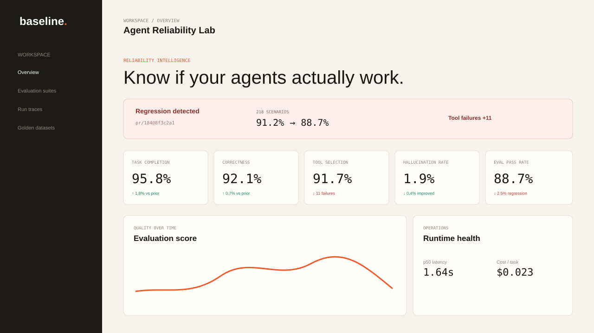

# baseline

**The reliability control plane for AI agents.**

Baseline answers one question: _How do we know this agent actually works?_

It is an eval-driven development platform with four task agents, 218 golden regression scenarios, trace-level observability, human review, and apples-to-apples model benchmarking across GPT, Claude, and Gemini.



## What is included

- Four reviewable agents: research, document analysis, support resolution, and structured-data extraction.
- A full run record: user task → planner → tool calls → final output → evaluator → score and failure class.
- Quality metrics: completion, correctness, tool selection, hallucination, failure, and evaluation pass rates.
- Operational metrics: p50/p95 latency, token volume, per-task cost, retries, and escalation rate.
- Six evaluation modes: deterministic checks, golden datasets, rubric scoring, provider-backed judge support, human review, and regression testing.
- Multi-model adapters for OpenAI, Anthropic, and Gemini, with a zero-cost deterministic provider for local development and CI.
- A GitHub Actions gate that runs all 218 scenarios on every pull request.
- A FastAPI/PostgreSQL backend and a responsive Next.js dashboard.

## Architecture

```text
User task
   ↓
Agent profile ──→ deterministic planner
   ↓                     ↓
Tool registry ←──── selected tool calls
   ↓
Provider adapter (GPT / Claude / Gemini / mock)
   ↓
Final output
   ↓
Evaluators ──→ score + rubric + failure classification
   ↓
PostgreSQL run, spans, usage, cost, review, and suite history
```

Every run remains useful even when it fails. Execution errors, incomplete answers, wrong tools, hallucinations, and incorrect answers are persisted as explicit failure classes rather than disappearing into logs.

See [the detailed architecture](docs/architecture.md) for the data model and extension points.

## Run locally

The fastest path is Docker:

```bash
cp .env.example .env
docker compose up --build
```

Open [http://localhost:3000](http://localhost:3000). The API and its interactive schema are at [http://localhost:8000/docs](http://localhost:8000/docs).

Baseline starts with a clearly labeled demo dataset, so the complete dashboard is useful without provider keys. Add any keys you want to benchmark to `.env`; missing providers remain visible but unavailable.

### Run without Docker

```bash
cd backend
python -m venv .venv
source .venv/bin/activate
pip install -e ".[dev]"
uvicorn app.main:app --reload
```

In a second terminal:

```bash
cd frontend
npm install
npm run dev
```

## Run the evaluation gate

```bash
cd backend
python -m app.evals.cli --provider mock --all --baseline 0.90 --threshold 0.01
```

The command exits non-zero when the new success rate falls more than the allowed threshold below the baseline. A pull request therefore gets a concise, enforceable signal:

```text
REGRESSION: 218 agent evals
Previous: 91.2%
Current:  88.7% (-2.5%)
Failures: {'tool_selection': 18, 'incorrect_answer': 5, 'hallucination': 2}
p95 latency: 2730ms | cost: $6.0200
```

The checked-in deterministic suite currently passes all 218 scenarios. The dashboard includes a seeded regression snapshot to demonstrate the triage workflow; it is explicitly marked as demo data whenever the live API is unavailable.

## Run a single trace

```bash
curl -X POST http://localhost:8000/api/runs \
  -H 'Content-Type: application/json' \
  -d '{
    "task": "Extract the email, date, and amount fields, then validate the record schema.",
    "agent_type": "extraction",
    "provider": "mock",
    "context": {
      "text": "Owner ada@example.com; renewal 2026-10-01; value $4200.00.",
      "required": ["emails", "dates", "amounts"]
    },
    "scenario_id": "extraction-001"
  }'
```

The response contains the planner output, every trace span, token and cost data, the final output, rubric scores, and a failure classification.

## API surface

| Endpoint | Purpose |
| --- | --- |
| `GET /api/dashboard` | Aggregated quality, operations, benchmark, and regression data |
| `GET /api/agents` | Agent contracts, tools, models, and provider readiness |
| `GET /api/scenarios` | Browse and filter the 218-scenario golden catalog |
| `POST /api/runs` | Execute and evaluate one fully traced agent task |
| `GET /api/runs/{id}` | Inspect a complete run trace |
| `POST /api/runs/{id}/reviews` | Attach a human verdict and score |
| `POST /api/runs/{id}/judge` | Run and persist an on-demand LLM-as-judge rubric |
| `POST /api/evaluations/regression` | Run a gated evaluation suite |
| `POST /api/benchmarks/compare` | Compare providers on the same scenario slice |

## Repository map

```text
backend/
  app/agents/       agent contracts, planner, orchestration
  app/tools/        typed local tool registry
  app/providers/    OpenAI, Anthropic, Gemini, and mock adapters
  app/evals/        218 scenarios, rubrics, regression and benchmark runners
  app/services/     demo seeding and metric aggregation
  tests/            unit, API, trace, and full-suite checks
frontend/
  app/              Next.js App Router shell and design system
  components/       dashboard, charts, and trace explorer
.github/workflows/  PR evaluation gate and production build checks
```

## Design decisions

- **Custom orchestration:** the planner and tool loop are deliberately small and inspectable. Framework abstractions can be introduced after traces establish the actual workflow shapes.
- **Provider-neutral evidence:** tool observations are collected before model synthesis, so the same evidence packet can be evaluated across providers.
- **No paid calls in CI:** the deterministic adapter makes PR gates repeatable, fast, and free. Provider benchmarks are explicit opt-in operations.
- **Pricing is configuration:** per-million-token rates live in environment variables because pricing changes. The included defaults are dated September 2026.
- **Human review is first-class:** reviews are separate immutable records, preserving the automated score for calibration analysis.


## License

MIT
