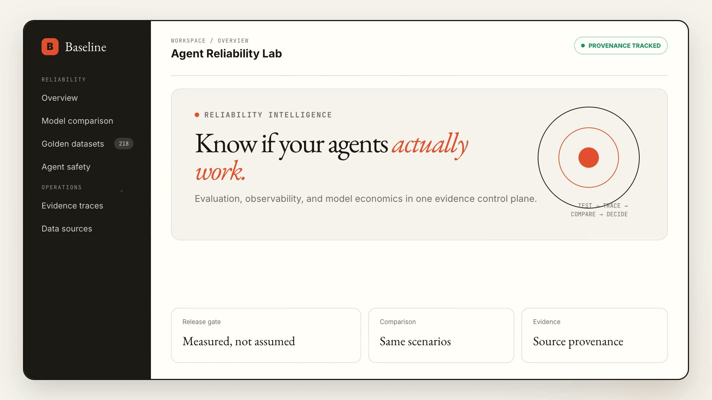
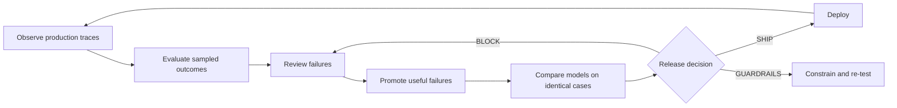

# Baseline

<p align="center">
  <strong>The evidence control plane for production AI agents.</strong><br>
  Test the same scenarios across models, inspect what every agent used, and make deployment decisions from evidence instead of demos.
</p>

<p align="center">
  <a href="https://github.com/Gaurav890/baseline/actions/workflows/evals.yml"></a>
  <a href="https://github.com/Gaurav890/baseline/stargazers"></a>
  <a href="LICENSE"></a>
  
</p>

[](docs/media/baseline-demo.mp4?raw=1)

<p align="center">
  <a href="docs/media/baseline-demo.mp4?raw=1"><strong>▶ Watch the 23-second product overview</strong></a>
  ·
  <a href="#quick-start"><strong>Run it locally</strong></a>
  ·
  <a href="docs/architecture.md"><strong>Read the architecture</strong></a>
</p>

<p align="center">
  <small>Music: <a href="https://ende.app/en/song/12876-happy-beats-business-moves-vol-11">“Happy Beats &amp; Business Moves Vol. 11”</a> by Sascha Ende, licensed under <a href="https://creativecommons.org/licenses/by/4.0/">CC BY 4.0</a>.</small>
</p>

> If this project helps you build more reliable agents, [star the repository](https://github.com/Gaurav890/baseline) so other builders can find it.

## What Baseline answers

Most agent demos answer: **“Can it work once?”**

Baseline answers the questions that appear before a real deployment:

| Question | What Baseline provides |
| --- | --- |
| Which model should we use? | Controlled experiments where every candidate receives the same immutable scenario IDs. |
| Did the new version regress? | A release gate against exactly 218 versioned golden scenarios and a real previous experiment. |
| Why did the agent produce this answer? | Evidence-rich traces with source URL, retrieval time, content hash, connector, latency, and provenance. |
| Are those sources actually live? | Persisted connector health checks; configuration alone is never displayed as `LIVE`. |
| What is failing in production? | Trace ingestion, sampled online checks, user feedback, and a human-review queue. |
| How does a failure become a test? | Reviewed production failures can be promoted into immutable candidate dataset versions. |
| Can the agent exceed its authority? | Versioned policies for scope, tools, mutation, budget, runtime, approval, and audit events. |
| Should this pull request ship? | A verified GitHub webhook contract that can publish an evaluation check on the PR head SHA. |

## The production reliability loop



Baseline connects offline evaluation, online signals, model comparison, agent safety, and release checks in one inspectable system. It keeps deterministic regression snapshots separate from non-blocking live canaries, so an upstream outage cannot silently corrupt the release gate.

## What is included

- **Controlled model comparisons** — persisted experiments across OpenAI, Anthropic, and Gemini candidates using the same scenario cohort.
- **A real golden catalog** — exactly 218 blocking scenarios, including 32 versioned snapshots derived from public SEC and GitHub data and 12 public GitHub pull-request cases.
- **Evidence-aware agents** — research, document, support, extraction, due diligence, release-risk, and incident-response workflows.
- **Production feedback** — trace ingestion, sampled online evaluators, user feedback, human review, and dataset promotion.
- **Agent safety controls** — scope, authority, budget, verification, containment, and auditability enforced in the runner.
- **Production connectors** — SEC EDGAR, Tavily, GitHub, and protected HTTPS retrieval with provenance metadata.
- **Durable evaluation jobs** — idempotent job creation, PostgreSQL state, Redis delivery, leases, renewal, and bounded retries.
- **Deployment contracts** — Vercel frontend plus Render API, worker, PostgreSQL, and Redis definitions.

## See it in three minutes

After starting the project, open [http://localhost:3000](http://localhost:3000) and follow this path:

1. **Data sources** — run a connector check and see the difference between configured, healthy, and proven live.
2. **Golden datasets** — browse the fixed release cases without exposing hidden answers.
3. **Model comparison** — select two or more configured providers and run the same cases against each candidate.
4. **Evidence traces** — inspect tool calls, hashes, latency, and `LIVE`, `SNAPSHOT`, or `SYNTHETIC` provenance.
5. **Human review** — see how negative feedback and failed evaluations become review work and candidate tests.
6. **Workflow Lab** — inspect multi-step due-diligence, release-risk, and incident-response examples.
7. **Agent safety** — review the policy boundary and the gaps the platform deliberately does not pretend to solve.

## Quick start

Requirements: Docker Desktop and Docker Compose.

```bash
git clone https://github.com/Gaurav890/baseline.git
cd baseline
cp .env.example .env
docker compose up --build
```

Then open:

- Dashboard: [http://localhost:3000](http://localhost:3000)
- API documentation: [http://localhost:8000/docs](http://localhost:8000/docs)
- Liveness: [http://localhost:8000/health/live](http://localhost:8000/health/live)
- Readiness: [http://localhost:8000/health/ready](http://localhost:8000/health/ready)

Local mode starts empty. To load the explicitly synthetic showcase, set both values below and restart:

```dotenv
DEMO_MODE=true
NEXT_PUBLIC_DEMO_MODE=true
```

Production rejects demo mode, fixture connectors, SQLite, inline jobs, insecure frontend origins, and a missing SEC contact identity. It never silently substitutes demo metrics when the API is empty or unavailable.

### Run without Docker

```bash
cd backend
uv sync --dev
uv run alembic upgrade head
uv run uvicorn app.main:app --reload
```

In a second terminal:

```bash
cd frontend
npm ci
npm run dev
```

## Configure real evidence and models

Baseline works without paid provider keys when you use the deterministic mock provider. Add only the integrations you want to exercise.

| Integration | Required configuration | Purpose |
| --- | --- | --- |
| SEC EDGAR | `SEC_USER_AGENT="Baseline Reliability your-email@gmail.com"` | Public submissions and company facts; no API key required. |
| GitHub | Optional `GITHUB_TOKEN` | Public issues and bounded PR evidence; a token raises limits or grants explicitly scoped private access. |
| Tavily | `TAVILY_API_KEY` | Allowlisted web search. |
| OpenAI | `OPENAI_API_KEY` | Model candidate for experiments and runs. |
| Anthropic | `ANTHROPIC_API_KEY` | Model candidate for experiments and runs. |
| Gemini | `GEMINI_API_KEY` | Model candidate for experiments and runs. |

Check a configured connector instead of assuming it works:

```bash
curl -X POST http://localhost:8000/api/integrations/sec_edgar/check
curl -X POST http://localhost:8000/api/integrations/github/check
curl -X POST http://localhost:8000/api/integrations/tavily/check
```

The dashboard labels a source `LIVE` only after a successful check. Every retrieved observation records its URL, timestamp, SHA-256 hash, connector, latency, and provenance.

## Run a controlled model comparison

The dashboard’s **New comparison** action is the easiest path. Configure at least two provider keys, select the current production baseline, choose 20, 60, or all 218 cases, and review the estimated call count before starting.

The API contract is also available directly:

```bash
curl -X POST http://localhost:8000/api/experiments \
  -H 'Content-Type: application/json' \
  -H 'Idempotency-Key: model-selection-2026-10-10' \
  -d '{
    "name":"Production model selection",
    "scenario_limit":20,
    "candidates":[
      {"provider":"openai","role":"baseline"},
      {"provider":"anthropic","role":"candidate"},
      {"provider":"gemini","role":"candidate"}
    ]
  }'
```

The result stores rubric quality, pass rate, correctness dimensions, p50/p95 latency, cost, and failure classes. The deployment recommendation is calculated from measured quality, policy violations, unsupported sources, latency, and cost:

- `SHIP`
- `SHIP_WITH_GUARDRAILS`
- `BLOCK`

A first experiment honestly reports **No baseline**. Historical deltas are used only when the dataset version and ordered scenario IDs match exactly.

## Golden datasets, snapshots, and canaries

The 218-case blocking catalog stays deterministic:

| Category | Scenarios |
| --- | ---: |
| GitHub release risk | 12 |
| Research | 43 |
| Document analysis | 55 |
| Support and multi-tool | 54 |
| Structured extraction | 54 |
| **Total** | **218** |

Thirty-two cases are frozen from primary public SEC and GitHub payloads. Their source URLs, selected fields, retrieval timestamps, and response hashes live under [`backend/app/evals/snapshots/`](backend/app/evals/snapshots/).

Live SEC and GitHub canaries are intentionally separate and non-blocking. They detect connectivity and schema drift without changing deterministic CI results.

## Architecture

```text
Browser ──HTTPS──> Next.js / Vercel
                       │
                       └──HTTPS──> FastAPI / Render ──> PostgreSQL
                                               │
                                               └──Redis──> Evaluation worker
                                                              │
                                    SEC / GitHub / Tavily <────┘
```

FastAPI owns validation, persistence, safety decisions, webhook verification, and job creation. The worker owns long-running regression and experiment execution. PostgreSQL is canonical state; Redis is delivery infrastructure, not a result store.

Read the complete [architecture and trust-boundary documentation](docs/architecture.md).

## Agent safety model

Every registered agent has a persisted policy that controls:

- allowed tools and external mutation;
- maximum tool calls and wall-clock runtime;
- estimated model-spend ceiling;
- approval requirements;
- an environment-wide execution kill switch;
- append-only safety events linked to the policy version and run.

The current tool registry is non-mutating and does not execute arbitrary code. The posture endpoint honestly reports sandbox isolation, covert-channel detection, authenticated workspaces, and retention automation as incomplete where they are not implemented.

## Production jobs and PR checks

Long evaluations use a persistent, idempotent job contract. Local development uses the same state machine inline; production uses Redis-backed workers with leases and bounded retries.

```bash
curl -X POST http://localhost:8000/api/evaluation-jobs \
  -H 'Content-Type: application/json' \
  -H 'Idempotency-Key: pr-184-head-8f3c2a1' \
  -d '{"kind":"regression","regression":{"provider":"mock","limit":218,"threshold":0.01}}'
```

Poll `GET /api/evaluation-jobs/{id}` and read `GET /api/evaluation-jobs/{id}/results`.

<details>
<summary><strong>Configure GitHub pull-request evaluation checks</strong></summary>

No GitHub App is created by this repository. Create one owned by the target organization or account:

1. Grant **Pull requests: Read-only**, **Checks: Read and write**, and **Metadata: Read-only**.
2. Subscribe only to **Pull request** events.
3. Set the webhook URL to `https://<api-host>/api/webhooks/github`.
4. Generate a strong webhook secret, select `application/json`, and keep SSL verification enabled.
5. Install the App only on repositories that should run evaluations.
6. Set `GITHUB_WEBHOOK_SECRET`, `GITHUB_APP_ID`, `GITHUB_PRIVATE_KEY`, and the exact `GITHUB_REPOSITORY_ALLOWLIST=owner/repository`.
7. Configure `GITHUB_EVALUATION_PROVIDER` and optionally `GITHUB_EVALUATION_MODEL` to the real candidate used by the product.
8. Enable `GITHUB_CHECKS_ENABLED=true` only after the complete setup is deployed to both API and worker.

The endpoint verifies `X-Hub-Signature-256`, bounds payload size, validates delivery IDs, filters event/action types, and rejects repositories outside the allowlist. Installation tokens are short-lived. A configured `GITHUB_TOKEN` is only a fallback and must have Checks write access.

</details>

## API at a glance

| Endpoint | Purpose |
| --- | --- |
| `GET /api/dashboard` | Observed quality, operations, benchmarks, and suite history |
| `GET /api/agents` / `GET /api/workflows` | Agent contracts and complex workflow catalog |
| `GET /api/integrations` | Connector configuration and proven health |
| `POST /api/runs` | Execute an agent task and persist its trace |
| `POST /api/evaluation-jobs` | Create idempotent regression or benchmark work |
| `POST /api/experiments` | Start a same-cohort multi-model comparison |
| `POST /api/traces/ingest` | Import and redact production traces idempotently |
| `GET /api/review-queue` | Triage feedback and failed runs |
| `POST /api/runs/{id}/promote` | Create an immutable candidate dataset version |
| `POST /api/canaries/run` | Execute non-blocking live connector checks |
| `GET /api/safety` | Inspect active policies, events, and acknowledged gaps |
| `POST /api/webhooks/github` | Receive verified pull-request events |

The complete interactive contract is available at `/docs` when the API is running.

## Deploy

[`render.yaml`](render.yaml) provisions the API, worker, PostgreSQL, and Redis. Create a Render Blueprint, fill every `sync: false` value, verify `/health/ready`, and set `FRONTEND_ORIGIN` to the final HTTPS frontend origin.

For Vercel, import this repository with `frontend` as the Root Directory and set:

```dotenv
NEXT_PUBLIC_API_URL=https://<render-api-host>
NEXT_PUBLIC_DEMO_MODE=false
```

Do not expose PostgreSQL or Redis publicly. Keep GitHub checks disabled until the least-privilege App configuration is complete.

## Verify the project

```bash
cd backend
uv run ruff check app tests
uv run pytest -q
ENVIRONMENT=test BASELINE_FIXTURE_CONNECTORS=true \
  uv run python -m app.evals.cli --provider mock --all --baseline 0.90 --threshold 0.01
uv run alembic upgrade head
```

```bash
cd frontend
npm ci
npm run lint
NEXT_PUBLIC_DEMO_MODE=false \
NEXT_PUBLIC_API_URL=https://api.example.invalid \
  npm run build
```

CI runs backend static analysis and tests, all 218 blocking evaluations, migration validation, the production-mode frontend build, and deployment-definition checks.

## Current boundary

Baseline is designed for a private, access-controlled deployment today. It does **not** yet claim a complete public multi-tenant SaaS boundary: human authentication, workspace membership and roles, isolated arbitrary-code execution, covert-channel detection, and automated retention/legal-hold policy still require implementation.

This distinction is intentional. The product should make missing controls visible instead of turning incomplete safety work into a green badge.

## Project map

```text
backend/                 FastAPI, agents, evals, connectors, jobs, and Alembic
frontend/                Next.js dashboard and experiment workflow
backend/app/evals/       Golden catalog, evaluators, live canaries, and snapshots
docs/architecture.md     System design, invariants, and trust boundaries
render.yaml              Render API, worker, PostgreSQL, and Redis blueprint
.github/workflows/       CI release gate
```

## License

[MIT](LICENSE)

---

<p align="center">
  <strong>Evidence before deployment.</strong><br>
  If that is how you want agents to ship, <a href="https://github.com/Gaurav890/baseline">star Baseline</a>.
</p>
